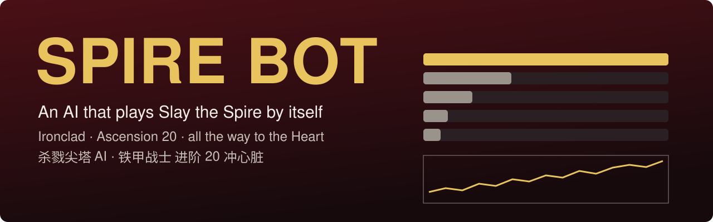
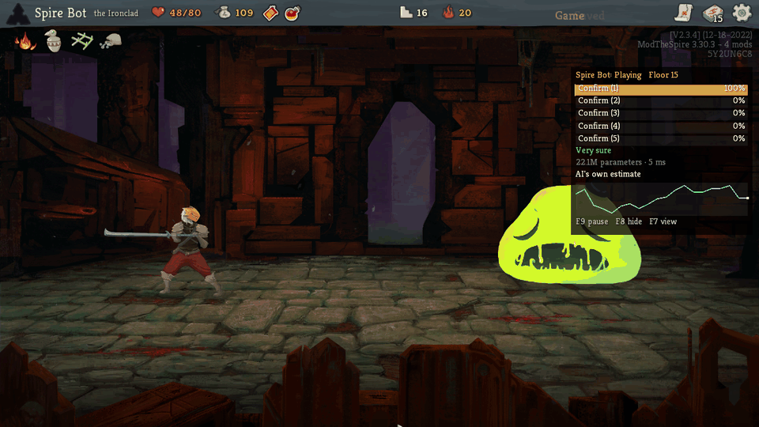
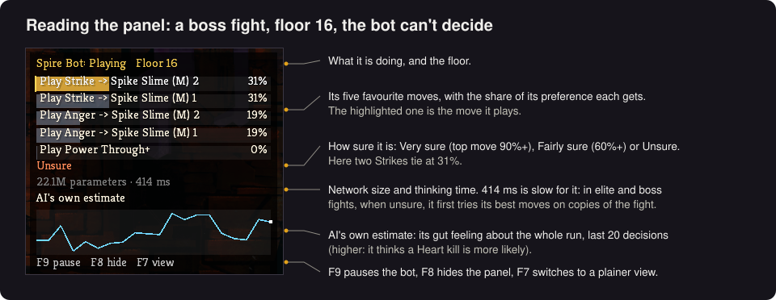
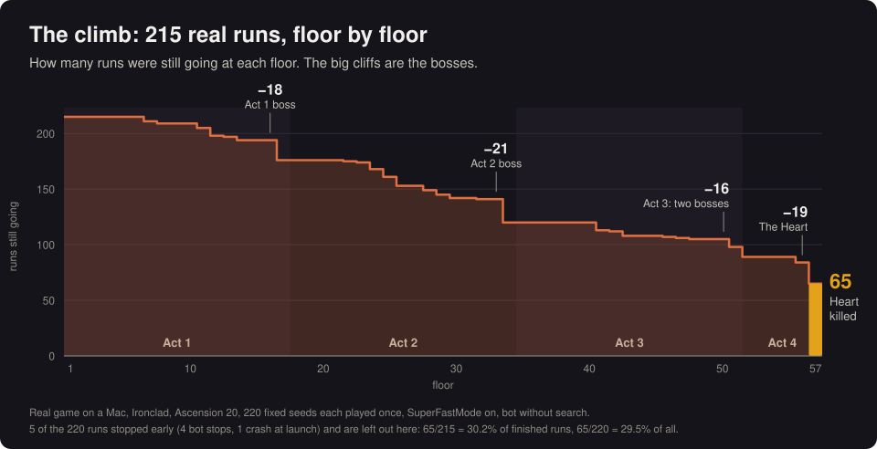
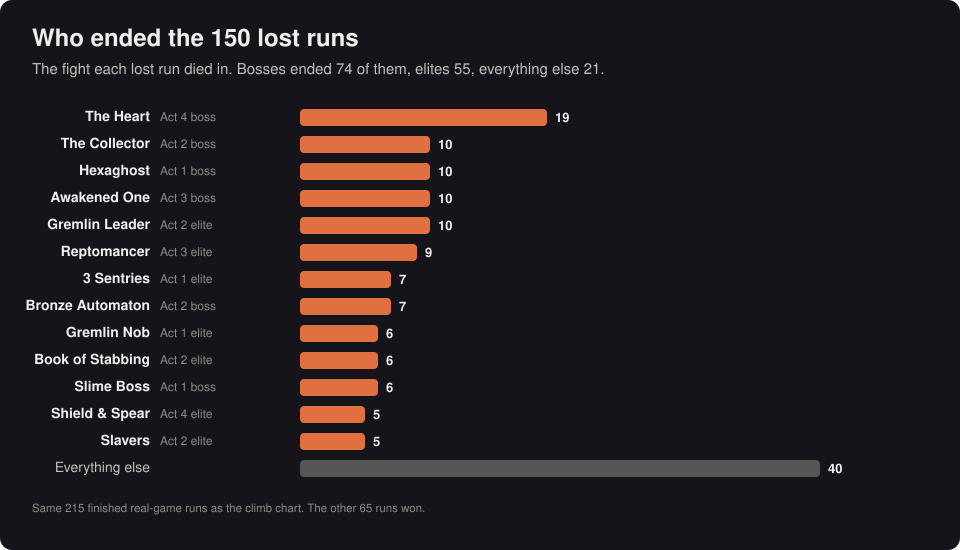
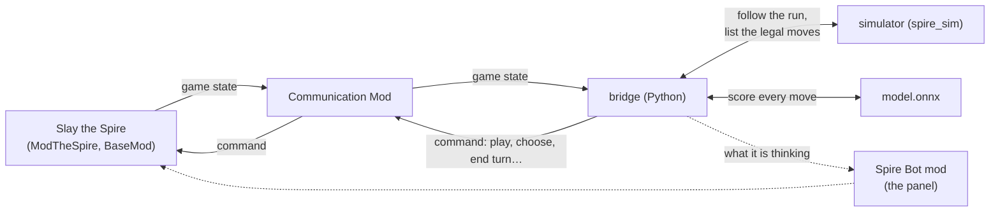

  

# Spire Bot

Spire Bot is a bot that plays Slay the Spire in your own copy of the game. You start the game with mods; the bot
starts an Ironclad run from the main menu, plays it to the end by itself, and goes for the Heart. You get to sit back
and watch it sweat.

No game files are included. You need Slay the Spire on Steam.

  

A whole Act 1 boss fight (Slime Boss, Ascension 20), played by the bot with nobody touching the
keyboard, then the boss relic pick. Recorded from the game's own frames with this package on a Mac; sped up 2.5×.

## What's in the corner?

While it plays, the bot thinks out loud in a small panel: the moves it likes best, how sure it is, and how it feels
about the run as a whole.

  

## How well does it play?

Ascension 20 is the game's hardest difficulty, and the Heart is its true final boss. In the real game the bot killed
the Heart in **65 of 220 first plays (29.5%)**, or **65 of the 215 runs that finished (30.2%)**. That was measured on
a Mac with the SuperFastMode mod (it speeds up the game's animations), with an earlier build of this package and the same
model weights, before the search in elite and boss fights was added. Since version 0.1.1 the package plays that way
by default too (search off); `MODEL_CARD.md` has the details.

  

Where does it lose? Mostly to the bosses and elites, and most of all to the Heart itself:

  

## How it works

- The game, with **ModTheSpire**, **BaseMod** and **Communication Mod**, reports the current game state and accepts
  commands.
- The bridge (`bridge/spire_bot`, Python) follows the game in a simulator, so it knows the position and the legal
  actions. It builds the network's input from what the game reports, asks the model for a score for every legal
  action, and sends the chosen command back to the game.
- The model (`model.onnx`, downloaded separately from https://huggingface.co/xlychee/spire-bot) only sees what a
  player sees in the position the game reports. In elite and boss fights the bridge can also search: when the model is
  unsure, it tries its best few options on copies of the fight in which the cards still to come are drawn again (never
  the real ones) and plays the one that does best on average. The search is off by default; `search = "1"` in
  `spire-bot.toml` turns it on for stronger play. The bridge itself also reads two things in the game's folder: the game's autosave, to
  get back in step when the simulator and the game disagree, and the profile's unlock and language settings.
  Nothing is sent anywhere. When two options score the same (within a small tolerance), a fixed tie rule takes
  the first, so every computer chooses the same.
- A small Java mod (`mod/`, `spirebot.jar`) does two things the game state cannot do by itself: in the Surrounded
  fight it turns the player toward the monster a card or potion is aimed at, as the mouse does; and it draws the
  bot's panel in the corner of the screen (F9 pause/resume, F8 hide).
- The simulator is distributed compiled inside the player's package; its source is not part of this repository.

## Install

Requirements:

- Slay the Spire on Steam. Windows 10/11 64-bit, or a Mac with Apple silicon (macOS 13 or later).
- A profile with Act 4 unlocked, all Ironclad cards unlocked, and the Ascension level you want the bot to play
  unlocked for Ironclad.
- No unfinished Ironclad run. Starting a run would overwrite it, so the bot refuses while the main menu shows
  "Continue" for Ironclad.
- No other mods that change cards, relics, monsters or events. The bot only knows the base game.

Steps:

1. In the Steam Workshop for Slay the Spire, subscribe to ModTheSpire, BaseMod and Communication Mod.
2. Unzip the `spire-bot` package into a folder without spaces in its path.
3. Download the model file `model.onnx` (from the Hugging Face page above) and put it into the package's `models/` folder.
4. Run `install.bat` (Windows) or `install.sh` (Mac). It finds the game, copies `spirebot.jar` into the game's
   `mods` folder and tells Communication Mod to start the bot.
5. Start Slay the Spire from Steam, choose **Play With Mods**, tick BaseMod, Communication Mod and Spire Bot, and
   press Play.
6. At the main menu the bot starts a run within a few seconds. Do not click or press keys while it plays.

The package's `README.md` and `README.zh.md` have the full steps, the settings, uninstall and troubleshooting.

## Known limits

- One run per game start. When the run ends the bot stops; restart the game to play another one.
- The bot occasionally stops in the middle of a run when the game does something its simulator cannot follow. The
  reason is written to `logs/bot.log`, and the run's log folder has the states and commands.
- Tested with the game in Simplified Chinese. Other languages should work (the bot reads ids, not names) but have
  not been played.
- F9 has been pressed in a real game on a Mac (it paused the bot and let it go on); F8 has only been tested by
  calling its function directly, not on a keyboard.
- After some card choices in a fight the bot has to work out the order of the cards the game will deal; in the
  slowest case seen the game waits 3 to 4 seconds once (longer on a slower computer).

## Licenses

- The bridge (Python), the Java mod and the install scripts: MIT, see `LICENSE`.
- The simulator (`spire_sim`) is not in this repository; the package carries it compiled. It is free to use and to
  pass on unchanged; it may not be modified or reverse engineered (`LICENSES/spire_sim-binary.txt`).
- The model weights: CC BY 4.0, see `MODEL_CARD.md`.
- Third-party parts and their licenses: `LICENSES/README.md`.

Slay the Spire is a game by Mega Crit. This project is not affiliated with Mega Crit and contains no game files.
ModTheSpire, BaseMod and Communication Mod are separate projects, installed by the player from the Steam Workshop.
